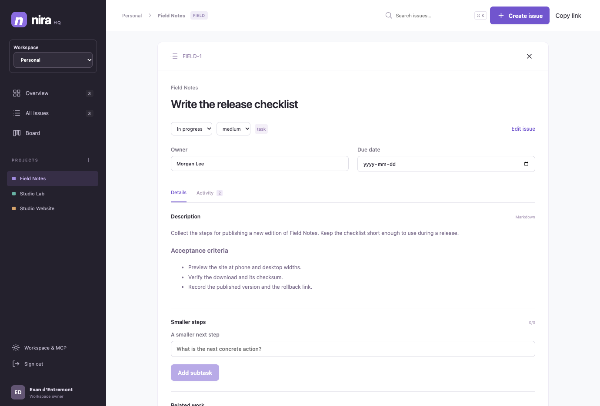

# Nira

Nira is a self-hosted, single-owner project and issue tracker with a browser workspace and MCP tools. It grew out of [Nira Legacy](https://github.com/Obscuretone/nira-legacy), the standalone CLI experiment. The app shell is editable in `frontend/dist/assets/workspace-app.js` and uses the components from the recovered frontend bundle.



The screenshot shows a direct issue link in a local demo with fictional data. See how Nira fits into the [self-hosted stack](https://obscuretone.com/posts/en/self_hosted_tools).

## Run locally

Install the locked requirements, create a private local configuration, then run the preview:

```sh
python3 -m venv .venv
. .venv/bin/activate
pip install -r requirements.lock
python scripts/local_config.py
NIRA_CONFIG=.private/local-config.json python scripts/preview.py
```

Open http://localhost:8865. Local credentials are generated under `.private/`.

## Run the tests

```sh
python -m pytest -q
```

## Hosted data and access

Use MariaDB behind an HTTPS proxy. Set the externally visible origin and cookie settings in a private configuration. Existing MariaDB installations should back up the database and apply `deploy/expand-text-mariadb.sql` before launching this version. Keep the production configuration, credentials and issue data outside this repository.

Use the owner browser session to create and revoke delegated API keys. Write-scoped keys can edit workspace records. Manage the keys from the browser workspace. See [MCP usage](docs/mcp.md) for transport details.

## Standalone email signup

For a new standalone instance, set `owner_signup_token` in the private Nira JSON
configuration to a high-entropy value such as the output of `openssl rand -hex 32`.
Omit `password_hash` and `oidc`, set `origin` and `path_prefix` for the instance,
and open its home page. Enter the setup token, owner email and password. The
database records exactly one owner and consumes the setup opportunity. Remove the
setup token from the configuration after signup. Future sign-ins use the saved email
and password. Existing deployments use their configured password and optional OIDC.

## Jira Cloud REST API

Use the Nira host as the base URL for these Jira Cloud REST v3 operations.

- Read a project or list projects through `/rest/api/3/project/{idOrKey}` and `/rest/api/3/project/search`.
- Create, read and edit issues, including creating subtasks with `fields.parent`.
- List and add comments, list and execute transitions, and create Blocks or Relates links.
- Search through `/rest/api/3/search/jql` with GET or POST and Jira-style pagination.
  Supported JQL uses equality on project, status and issue key, or contains on text and summary,
  joined with `AND`. Sort by `updated DESC`.

Set `jira_api_email` to use Jira-style Basic auth with a Nira API token as
the password. A new standalone owner can use their configured owner email.
Bearer tokens also work. Both schemes honor the token’s existing read/write scope.
Issue and project IDs are Nira identifiers and status/type IDs are instance mappings.
Write descriptions and comments as ADF v1 paragraphs with plain text and hard
breaks. The compatibility API uses the same projects, issues and statuses as the UI.

## Workspaces and direct links

Use the sidebar’s Workspace menu to switch or create a workspace. New projects belong to the selected workspace. In a project, use the Project workspace menu to move it and its issues. Workspace grouping uses the existing owner and delegated-token access model.

At startup Nira creates the Personal and Plugin company workspaces. Existing projects categorized as Plugin business go into Plugin company. Other existing projects appear in Personal until moved. Issue IDs and links survive workspace changes. Signed-in browser users opening a direct project or issue link see the same sidebar as regular navigation.
